# 德州扑克项目 — 系统工作流技术文档

---

> **文档版本**: v1.0  
> **最后更新**: 2026-05-16  
> **适用范围**: Texas Poker 全系统工作流  
> **读者对象**: 开发工程师、系统架构师、技术项目经理

---

## 目录

- [1. 系统架构总览](#1-系统架构总览)
- [2. 用户认证工作流](#2-用户认证工作流)
  - [2.1 身份验证机制](#21-身份验证机制)
  - [2.2 权限验证流程](#22-权限验证流程)
- [3. 游戏内数据交互流程](#3-游戏内数据交互流程)
  - [3.1 实时数据传输协议](#31-实时数据传输协议)
  - [3.2 状态同步机制](#32-状态同步机制)
- [4. 后端系统职责](#4-后端系统职责)
  - [4.1 数据处理流程](#41-数据处理流程)
  - [4.2 核心业务逻辑](#42-核心业务逻辑)
  - [4.3 安全验证机制](#43-安全验证机制)
  - [4.4 资源管理](#44-资源管理)
- [5. 端到端完整流程](#5-端到端完整流程)

---

## 1. 系统架构总览

系统采用**双进程架构**，HTTP 服务与 WebSocket 服务独立运行，通过 SQLite 数据库和进程内共享引用实现状态协作。

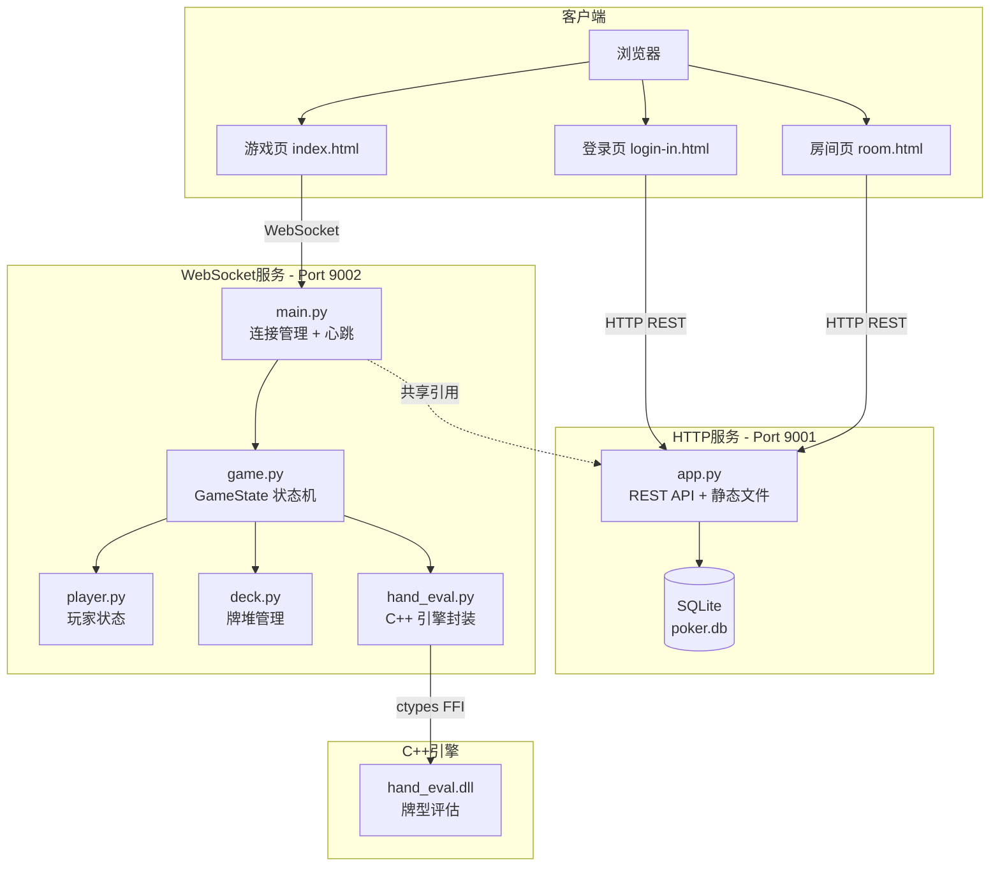

### 服务端口分配

| 服务 | 端口 | 协议 | 职责 |
|------|------|------|------|
| HTTP Server | 9001 | HTTP/1.1 | REST API、静态文件服务、用户认证、房间管理 |
| WebSocket Server | 9002 | WebSocket | 实时游戏通信、状态推送、心跳检测 |

### 数据库表结构

| 表名 | 用途 | 关键字段 |
|------|------|----------|
| `users` | 用户账户 | id, username, password(bcrypt), token(UUID), chips |
| `rooms` | 房间配置 | id, name, max_players, initial_chips, created_by |
| `game_logs` | 操作日志 | id, room_id, player_id, action, amount, created_at |

---

## 2. 用户认证工作流

### 2.1 身份验证机制

系统采用**Token-Based 认证**模式，结合前端 SHA-256 哈希传输和后端 bcrypt 加密存储，实现多层安全防护。

#### 2.1.1 注册流程

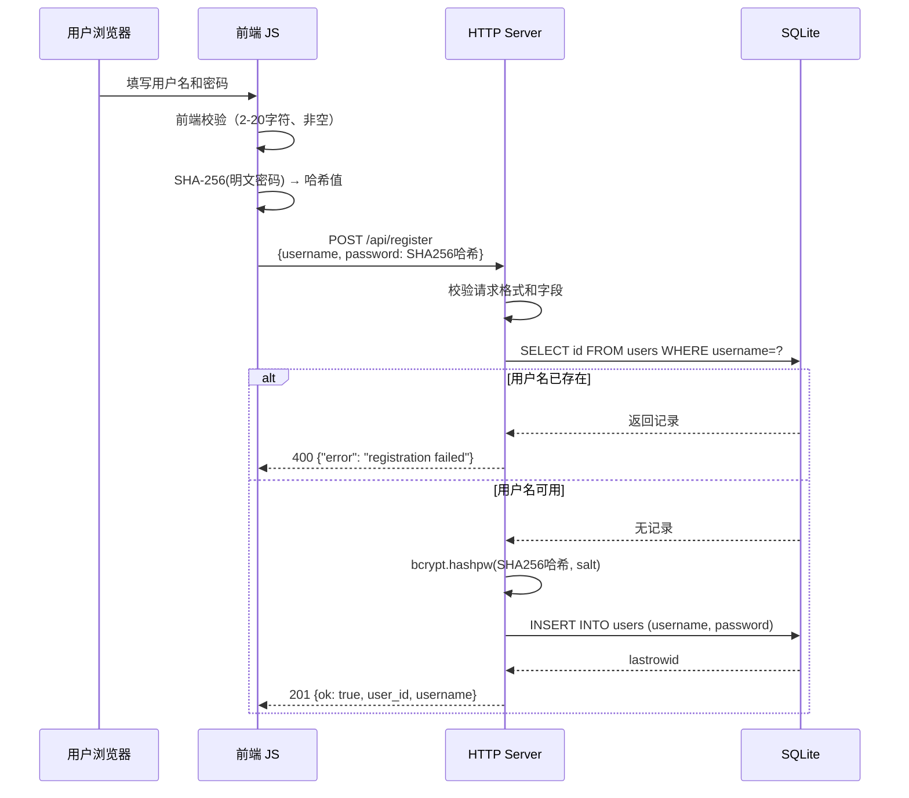

**关键安全设计**:

| 层级 | 机制 | 说明 |
|------|------|------|
| 传输层 | SHA-256 哈希 | 前端对密码做 SHA-256 后传输，防止明文嗅探 |
| 存储层 | bcrypt 加盐哈希 | 后端对收到的 SHA-256 值再做 bcrypt，防止彩虹表攻击 |
| 信息层 | 通用错误信息 | 注册失败返回 `"registration failed"`，防止用户名枚举 |

前端 SHA-256 实现（[app.js](file:///d:/gitproject/game/texas-poker/app.js)）:

```javascript
async function sha256(message) {
    const msgBuffer = new TextEncoder().encode(message);
    const hashBuffer = await crypto.subtle.digest('SHA-256', msgBuffer);
    const hashArray = Array.from(new Uint8Array(hashBuffer));
    return hashArray.map(b => b.toString(16).padStart(2, '0')).join('');
}
```

后端 bcrypt 存储（[app.py](file:///d:/gitproject/game/texas-poker/server/app.py)）:

```python
hashed_password = bcrypt.hashpw(password.encode("utf-8"), bcrypt.gensalt()).decode("utf-8")
cursor.execute("INSERT INTO users (username, password) VALUES (?, ?)", (username, hashed_password))
```

#### 2.1.2 登录流程

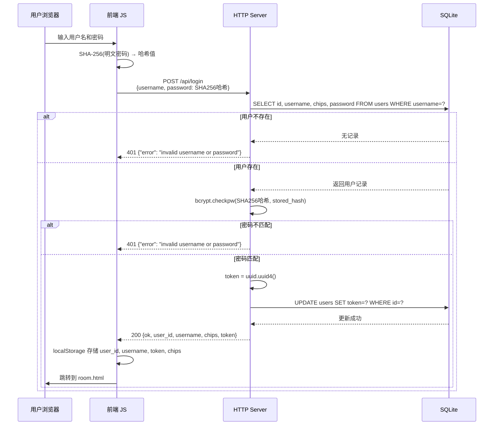

**Token 生命周期管理**:

- **生成**: 登录成功时由 `uuid.uuid4()` 生成 v4 UUID
- **存储**: 写入 `users` 表的 `token` 字段，覆盖旧 Token（单点登录）
- **传递**: 前端存储在 `localStorage`，WebSocket 连接时携带
- **验证**: WebSocket `join` 消息中携带 token，服务端查询数据库比对
- **失效**: 重新登录生成新 Token，旧 Token 自动失效

登录成功后前端存储:

```javascript
localStorage.setItem('user_id', data.user_id);
localStorage.setItem('username', data.username);
localStorage.setItem('token', data.token);
localStorage.setItem('chips', data.chips);
```

### 2.2 权限验证流程

#### 2.2.1 HTTP 层权限控制

HTTP API 采用**接口级权限校验**，不同接口有不同的验证要求:

| 接口 | 方法 | 权限要求 | 验证方式 |
|------|------|----------|----------|
| `/api/register` | POST | 无 | 输入格式校验 |
| `/api/login` | POST | 无 | 用户名+密码校验 |
| `/api/rooms` | GET | 无 | 公开接口 |
| `/api/rooms` | POST | 无 | 输入校验 + XSS过滤 |
| `/api/rooms/:id/join` | POST | 需 user_id | 用户存在性校验 |
| `/api/rooms/:id/status` | GET | 无 | 公开接口 |
| `/api/users/:id` | GET | 无 | 公开接口 |

#### 2.2.2 WebSocket 层权限控制

WebSocket 连接采用**Token 认证 + 心跳保活**双重机制:

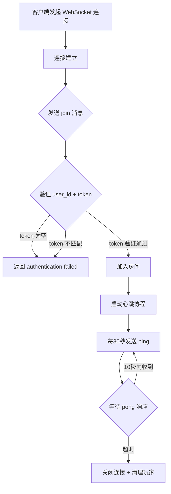

Token 验证实现（[main.py](file:///d:/gitproject/game/texas-poker/server/main.py)）:

```python
def verify_token(user_id, token):
    if not user_id or not token:
        return False
    conn = get_db()
    cursor = conn.cursor()
    cursor.execute("SELECT token FROM users WHERE id = ?", (int(user_id),))
    row = cursor.fetchone()
    return row and row["token"] == token
```

心跳检测实现:

```python
async def heartbeat(websocket):
    while True:
        await asyncio.sleep(HEARTBEAT_INTERVAL)  # 30秒
        try:
            pong = await websocket.ping()
            await asyncio.wait_for(pong, timeout=HEARTBEAT_TIMEOUT)  # 10秒超时
        except asyncio.TimeoutError:
            await websocket.close()
            break
```

---

## 3. 游戏内数据交互流程

### 3.1 实时数据传输协议

游戏内所有实时交互通过 **WebSocket 全双工通道**完成，采用 JSON 格式的消息协议。

#### 3.1.1 消息格式规范

所有消息遵循统一信封格式:

```json
{
    "type": "<消息类型>",
    "data": { <消息体> }
}
```

**客户端 → 服务端消息**:

| type | data 字段 | 触发场景 | 说明 |
|------|-----------|----------|------|
| `join` | `{user_id, room_id, token}` | 进入游戏页 | 加入房间，需 Token 认证 |
| `start_game` | 无 | 点击"开始游戏" | 触发新一局开始 |
| `player_action` | `{action, amount?}` | 点击操作按钮 | 玩家行动（fold/check/call/raise） |

**服务端 → 客户端消息**:

| type | data 字段 | 触发场景 | 说明 |
|------|-----------|----------|------|
| `joined` | `{room_id, player_id}` | join 成功 | 确认加入房间 |
| `game_state` | 完整游戏状态 | 每次状态变更 | 全量状态推送 |
| `hand_result` | `{winners, players}` | 摊牌完成 | 牌局结果通知 |
| `error` | `{message}` | 操作异常 | 错误提示 |

#### 3.1.2 game_state 数据结构

每次状态变更后，服务端推送完整的 `game_state`:

```json
{
    "type": "game_state",
    "data": {
        "phase": "preflop",
        "communityCards": [
            {"id": 0, "rank": "2", "suit": "♠", "rank_idx": 0, "suit_idx": 0}
        ],
        "players": [
            {
                "id": 1,
                "name": "Alice",
                "chips": 980,
                "currentBet": 20,
                "hand": [],
                "action": "call",
                "state": "active",
                "isCurrent": false
            }
        ],
        "pot": 40,
        "currentBet": 20,
        "dealerIndex": 0,
        "currentPlayerIndex": 1,
        "minRaise": 20
    }
}
```

> **注意**: `hand` 字段仅对当前玩家可见（前端过滤），其他玩家的手牌在摊牌前始终为空数组。

#### 3.1.3 延迟管理

| 机制 | 参数 | 说明 |
|------|------|------|
| 心跳间隔 | 30秒 | 定期检测连接存活 |
| 心跳超时 | 10秒 | pong 响应超时阈值 |
| 断线重连 | 5秒 | 前端自动重连间隔 |
| 按钮防抖 | 禁用态 | 操作后按钮立即禁用，防止重复提交 |

### 3.2 状态同步机制

#### 3.2.1 游戏状态机

游戏核心是一个六阶段状态机，由 `GameState` 类管理:

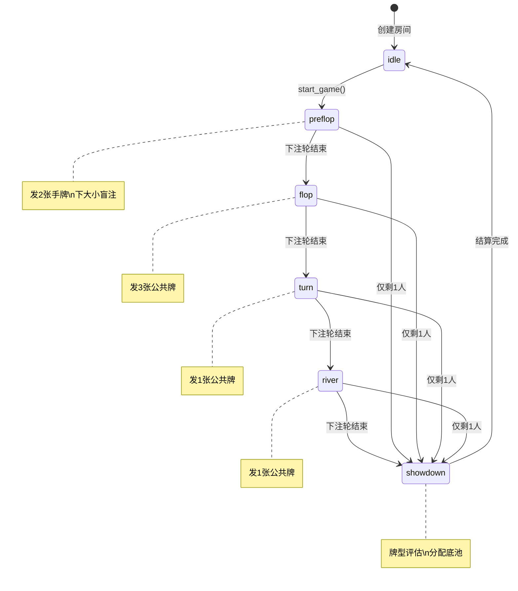

#### 3.2.2 状态更新频率与推送策略

系统采用**事件驱动的全量状态推送**模式:

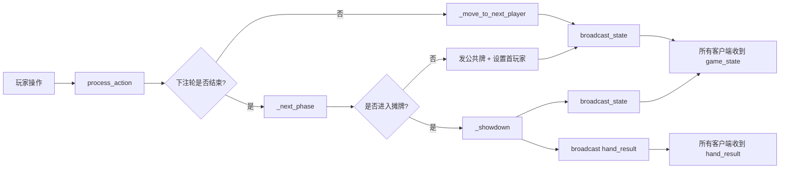

**推送时机**:

| 事件 | 推送消息 | 推送范围 |
|------|----------|----------|
| 玩家加入房间 | `game_state` | 除加入者外的所有玩家 |
| 游戏开始 | `game_state` | 房间内所有玩家 |
| 玩家操作（fold/check/call/raise） | `game_state` | 房间内所有玩家 |
| 阶段推进（flop/turn/river） | `game_state` | 房间内所有玩家 |
| 摊牌完成 | `game_state` + `hand_result` | 房间内所有玩家 |
| 玩家断线 | `game_state` | 房间内剩余玩家 |

#### 3.2.3 一致性保证

- **单一权威源**: 每个 `room_id` 对应唯一 `GameState` 实例，存储在 `main.py` 的 `rooms` 字典中
- **串行处理**: WebSocket 消息在 asyncio 事件循环中串行处理，无并发竞争
- **全量替换**: 每次推送完整的 `game_state`，客户端直接替换本地状态，无需增量合并
- **操作校验**: `process_action` 严格校验当前玩家身份，非当前玩家操作会被拒绝

---

## 4. 后端系统职责

### 4.1 数据处理流程

#### 4.1.1 请求数据验证

HTTP 请求经过多层验证管道:

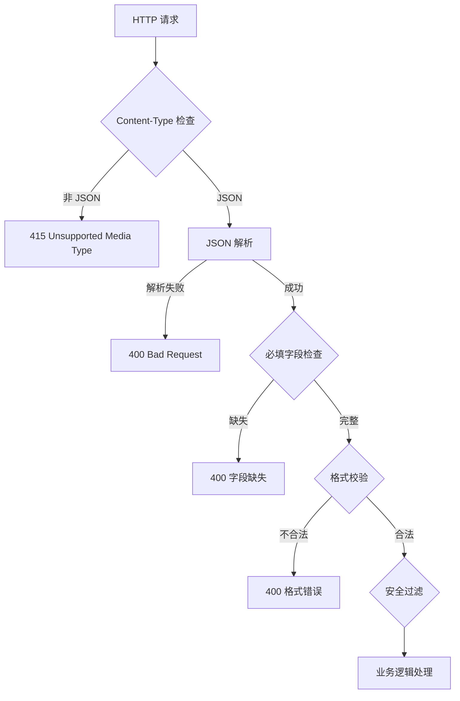

**输入校验规则**:

| 字段 | 规则 | 错误响应 |
|------|------|----------|
| username | 非空、2-20字符 | `"username must be 2-20 characters"` |
| password | 非空 | `"username and password cannot be empty"` |
| room name | 非空、≥2字符、XSS过滤、字符白名单 | `"room name contains invalid characters"` |
| max_players | 默认8 | — |
| initial_chips | 默认1000 | — |

#### 4.1.2 数据转换流程

卡牌数据在系统中经历多种编码转换:

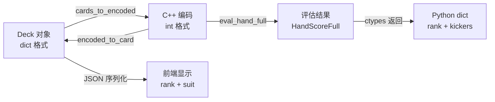

卡牌编码规则: `card_id = rank_idx × 4 + suit_idx`

| rank_idx | 牌面 | suit_idx | 花色 |
|----------|------|----------|------|
| 0 | 2 | 0 | ♠ |
| 1 | 3 | 1 | ♥ |
| ... | ... | 2 | ♦ |
| 12 | A | 3 | ♣ |

#### 4.1.3 数据持久化

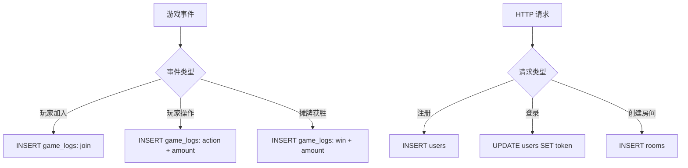

### 4.2 核心业务逻辑

#### 4.2.1 游戏状态机 — GameState

`GameState` 是游戏核心，管理完整的牌局生命周期:

**初始化流程** (`start_game`):

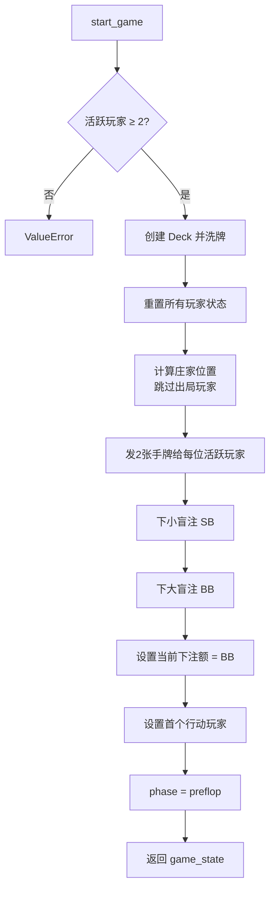

**盲注机制** (`_post_blinds`):

```python
sb_index = self._next_active_index(self.dealer_index)
bb_index = self._next_active_index(sb_index)

sb_amount = min(self.small_blind, sb_player.chips)  # 筹码不足则 all-in
sb_player.chips -= sb_amount
sb_player.current_bet = sb_amount
self.pot += sb_amount
```

#### 4.2.2 玩家操作处理 — process_action

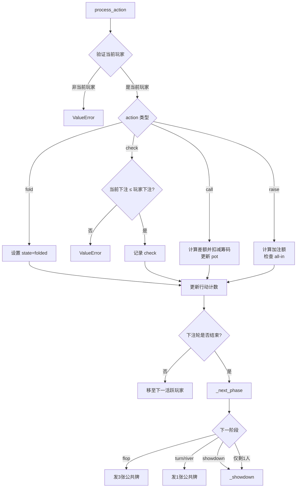

**底池金额守恒**:

每次 call/raise 操作中，通过 `chips_before - player.chips` 计算实际扣减金额并加入 `self.pot`，确保筹码守恒:

```python
elif action == "call":
    chips_before = player.chips
    call_amount = self.current_bet - player.current_bet
    player.call(call_amount)
    self.pot += chips_before - player.chips
```

**下注轮结束条件** (`_is_betting_round_over`):

```python
def _is_betting_round_over(self):
    active_players = [p for p in self.players if p.is_active()]
    if len(active_players) <= 1:
        return True
    all_equal = len(set(p.current_bet for p in active_players)) == 1
    all_acted = self._acted_count >= len(active_players)
    return all_equal and all_acted
```

#### 4.2.3 摊牌逻辑 — _showdown

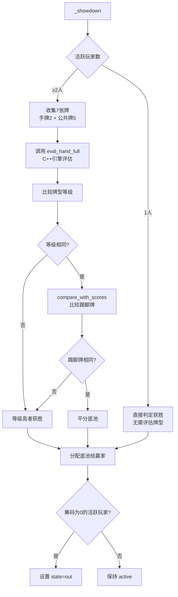

**C++ 牌型引擎调用链**:

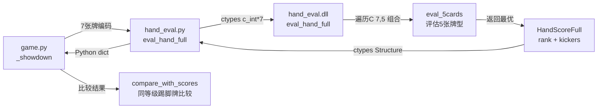

牌型等级体系:

| 等级值 | 牌型 | 英文名 |
|--------|------|--------|
| 9 | 皇家同花顺 | Royal Flush |
| 8 | 同花顺 | Straight Flush |
| 7 | 四条 | Four of a Kind |
| 6 | 葫芦 | Full House |
| 5 | 同花 | Flush |
| 4 | 顺子 | Straight |
| 3 | 三条 | Three of a Kind |
| 2 | 两对 | Two Pair |
| 1 | 一对 | One Pair |
| 0 | 高牌 | High Card |

### 4.3 安全验证机制

#### 4.3.1 输入净化

| 输入源 | 威胁 | 防御措施 | 实现位置 |
|--------|------|----------|----------|
| 房间名称 | XSS 注入 | `html.escape` + 正则白名单 | `sanitize_room_name()` |
| 用户名 | 长度攻击 | 2-20字符限制 | `register()` |
| 密码 | 明文嗅探 | SHA-256 前端哈希 | `app.js: sha256()` |
| WebSocket join | 身份冒充 | Token 查库验证 | `verify_token()` |
| 游戏操作 | 越权操作 | 当前玩家身份校验 | `process_action()` |

房间名称 XSS 过滤实现:

```python
def sanitize_room_name(name):
    name = html.escape(name, quote=True)
    allowed_pattern = re.compile(r'^[\w\u4e00-\u9fff\s\-·.,!?！？，。、]+$')
    if not allowed_pattern.match(name):
        raise BadRequestError("room name contains invalid characters")
    return name
```

#### 4.3.2 加密实现

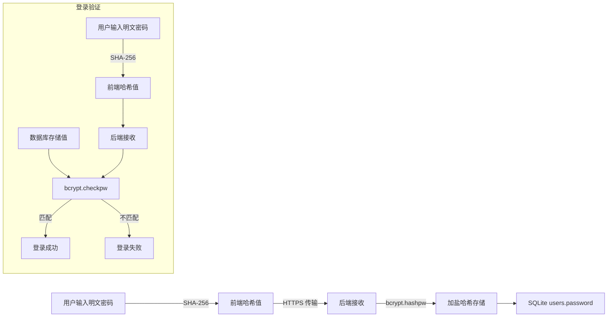

#### 4.3.3 攻击防护策略

| 攻击类型 | 防护措施 | 说明 |
|----------|----------|------|
| XSS | `html.escape` + 字符白名单 | 房间名称等用户输入严格过滤 |
| 用户名枚举 | 通用错误信息 | 注册失败返回 `"registration failed"` |
| 密码嗅探 | SHA-256 前端哈希 | 密码不在网络中明文传输 |
| 密码泄露 | bcrypt 加盐存储 | 即使数据库泄露也无法还原明文 |
| Token 伪造 | UUID v4 + 数据库验证 | 每次登录生成新 Token，查库比对 |
| WebSocket 冒充 | join 时 Token 校验 | 未认证连接无法加入游戏 |
| 连接劫持 | 心跳检测 | 30秒 ping/10秒超时，自动清理僵尸连接 |
| 越权操作 | 当前玩家校验 | `process_action` 严格验证操作者身份 |

### 4.4 资源管理

#### 4.4.1 数据库连接管理

采用 `threading.local()` 实现线程安全的连接复用:

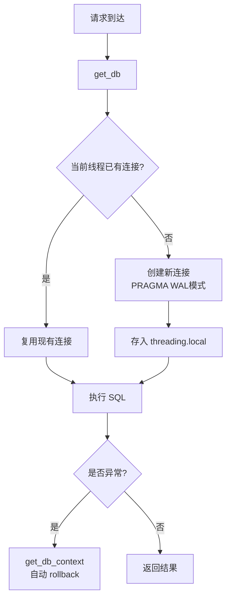

```python
_thread_local = threading.local()

def get_db():
    if not hasattr(_thread_local, 'connection') or _thread_local.connection is None:
        conn = sqlite3.connect(config.DB_PATH, timeout=30)
        conn.execute("PRAGMA journal_mode=WAL")
        conn.row_factory = sqlite3.Row
        _thread_local.connection = conn
    return _thread_local.connection
```

#### 4.4.2 WebSocket 连接生命周期

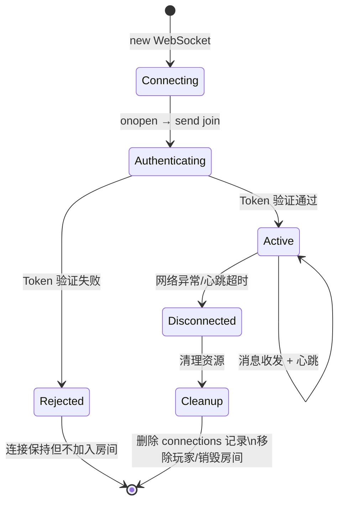

**房间资源回收**:

```python
# 玩家断线时的清理逻辑
finally:
    if heartbeat_task and not heartbeat_task.done():
        heartbeat_task.cancel()
    if player_id and player_id in connections:
        del connections[player_id]
    if room_id and room_id in rooms:
        game = rooms[room_id]
        game.remove_player(player_id)
        if game.get_player_count() == 0:
            del rooms[room_id]      # 最后一人离开时销毁房间
        else:
            await broadcast_state(room_id)  # 通知其他玩家
```

#### 4.4.3 C++ 引擎资源管理

牌型评估引擎以共享库形式加载，进程生命周期内常驻内存:

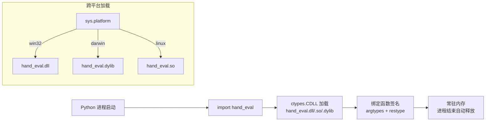

---

## 5. 端到端完整流程

以下展示一个完整的用户旅程，从登录到完成一局游戏:

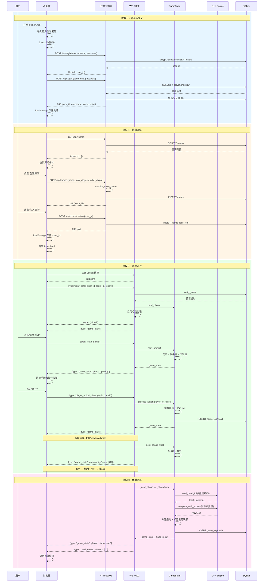

---

> **文档结论**: 本系统采用 HTTP + WebSocket 双协议架构，HTTP 负责用户认证和房间管理，WebSocket 负责实时游戏通信。认证采用 SHA-256 + bcrypt 双层加密和 UUID Token 机制，游戏状态由 GameState 状态机统一管理，牌型评估通过 ctypes FFI 调用 C++ 高性能引擎。整体设计在安全性、实时性和性能之间取得了合理平衡。
